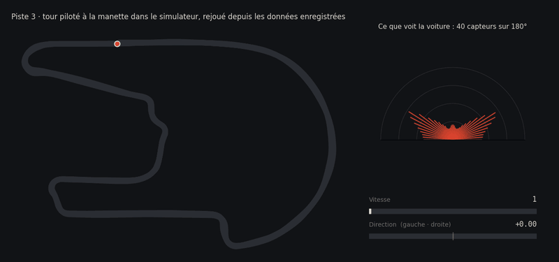
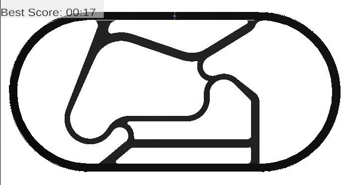
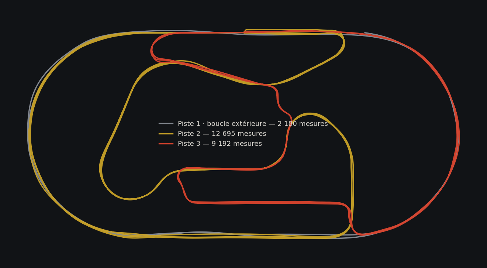
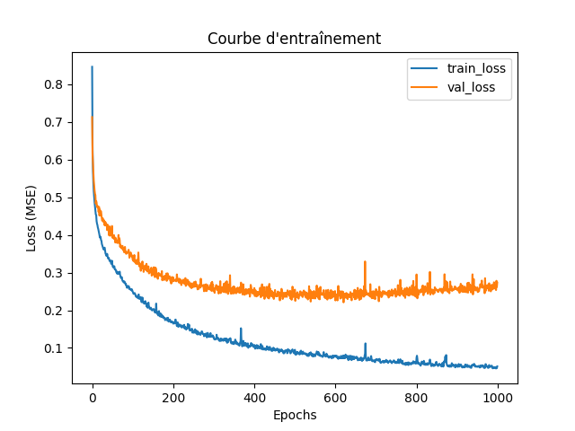
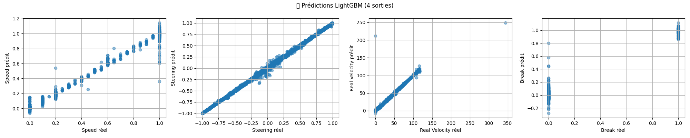
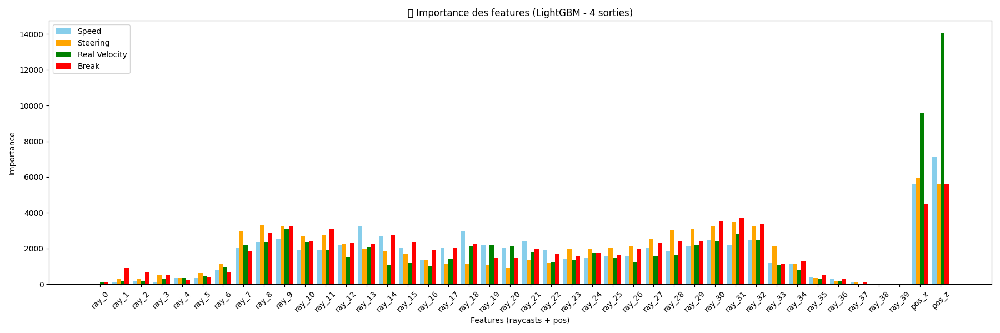

# Robocar — Bober, voiture autonome et IA de pilotage (Epitech Strasbourg, 2025)

> **EN** — Robocar is an Epitech project where every campus builds a miniature self-driving car; the first national
> final brought the 15 campuses to Paris in June 2025. In the Strasbourg team I designed the car, **Bober**, and
> built the simulator AI: I drove laps with a gamepad in a Unity racing simulator, recorded 40 distance sensors,
> speed and steering at every step, and trained models (TensorFlow, then LightGBM) to reproduce that driving alone.

**Robocar** est un projet d'Epitech : chaque campus construit une voiture miniature pilotée par une intelligence
artificielle embarquée. Avec l'équipe d'Epitech Strasbourg, nous avons construit **Bober**, une petite voiture rouge,
et l'avons amenée à la toute première **finale nationale**, qui réunissait les 15 campus pendant trois jours à
Epitech Paris, fin juin 2025.

La compétition comptait trois épreuves : le **design** de la voiture, une **course en autonomie** sur piste (caméra
et modèle entraîné, sur une carte NVIDIA Jetson) et une **course pilotée à la manette**. Notre design a été l'un des
coups de cœur parmi toutes les voitures présentées.

Ce dépôt présente ma partie logicielle : **l'IA de pilotage en simulateur**.

🎬 Animation (20 s) : un tour de la piste 3, rejoué depuis les mesures enregistrées, avec ce que « voit » la
voiture à chaque instant : [media/replay.mp4](media/replay.mp4)

## Apprendre à conduire en imitant

L'idée est l'**apprentissage par imitation** : plutôt que d'écrire des règles de conduite, on montre à la machine
comment conduire, puis on lui apprend à reproduire les gestes.

1. **Piloter et enregistrer** (`robot_ai.py`). Je conduis la voiture dans le simulateur Unity avec une manette
   Xbox 360 : gâchette pour l'accélérateur, joystick pour la direction. À chaque pas de simulation, le script
   enregistre une ligne : les **40 capteurs de distance** (des rayons répartis sur 180° devant la voiture, qui
   mesurent la distance au bord de la piste), la vitesse demandée, la direction et la position de la voiture.
2. **Entraîner** (`train_model_lightGBM.py`). Un modèle apprend à prédire, à partir des capteurs et de la position,
   ce que j'aurais fait : accélération, direction, vitesse réelle et freinage.
3. **Laisser conduire** (`autopilot.py`). Le script se connecte au simulateur, lit les capteurs à chaque pas,
   demande au modèle quoi faire et envoie l'accélération et la direction à la voiture. Il compte les tours et
   chronomètre chacun.

| Le circuit du simulateur | Les trois parcours enregistrés |
| --- | --- |
|  |  |

## Ce qui a marché, et ce qui n'a pas marché

- **Un réseau de neurones d'abord** (TensorFlow / Keras) : trois couches denses de 256, 256 et 128 neurones, avec
  normalisation et *dropout*. La courbe d'apprentissage descend bien, mais l'écart entre entraînement et validation
  montre qu'il apprend par cœur ; sur la piste, la voiture conduisait mal. Commit du 12 juin : *« Tensorflow is bad »*.
- **LightGBM ensuite** : des arbres de décision boostés, un modèle par sortie (`MultiOutputRegressor`), 4 000 arbres.
  Beaucoup plus stable sur ces données tabulaires, et les prédictions collent aux gestes réels.
- **Les virages et les freinages sont rares** dans un tour : la voiture apprenait surtout à aller tout droit. J'ai
  donc **sur-échantillonné** les moments difficiles (virages moyens ×5, virages serrés ×9, freinages ×5) avant
  l'entraînement, puis travaillé le freinage jusqu'à ce que la voiture passe le demi-tour de la piste 3.
- **Un modèle par piste** : la position fait partie des entrées et pèse lourd dans les décisions (graphique
  ci-dessous). Le modèle reconnaît donc *où* il est sur un circuit donné. C'est efficace pour une course, mais il
  faut un modèle par tracé : `model/track1`, `track2` et `track3`. Mes derniers commits fusionnent les trois jeux
  de données pour viser un modèle unique.

| Courbe d'apprentissage du réseau de neurones | Prédictions de LightGBM contre gestes réels |
| --- | --- |
|  |  |

Fonctionnement détaillé : [docs/ARCHITECTURE.md](docs/ARCHITECTURE.md) · Installation : [docs/INSTALL-fedora.md](docs/INSTALL-fedora.md)

## Technique

- Python, environ 1 100 lignes ; **ML-Agents** (`mlagents-envs` 0.28) pour piloter le simulateur Unity depuis Python.
- **pygame** pour la manette, **pandas** et **NumPy** pour les données, **scikit-learn** pour la normalisation et
  l'évaluation, **LightGBM** et **TensorFlow / Keras** pour les modèles, **Matplotlib** pour les graphiques.
- Environ 24 000 mesures retenues sur trois parcours, après tri des enregistrements ratés.

## Mon rôle

Projet d'équipe à **quatre**, campus de Strasbourg, année 2024-2025. J'ai dessiné la voiture, Bober, et j'ai écrit
seul l'IA de simulateur présentée ici (24 des 25 commits, du 7 au 23 juin 2025) : enregistrement à la manette,
nettoyage des données, essais TensorFlow puis LightGBM, sur-échantillonnage des virages, autopilote. Raphaël Gall a
branché LightGBM dans une première version de l'autopilote.

Sources : [l'article d'Epitech sur la finale](https://www.epitech.eu/2025/09/04/projet-robocar-la-grande-finale/)
· [le post d'Epitech Strasbourg](https://www.linkedin.com/feed/update/urn:li:activity:7346535447449272321/)

## Code source

Le code, les données enregistrées et les modèles entraînés sont dans un dépôt privé :
[FuniclemDev/MyRobocarIA](https://github.com/FuniclemDev/MyRobocarIA) (accès sur demande). Le simulateur Unity,
fourni par Epitech, n'est pas public et n'est pas inclus.

---
Clément Dorge · [clementdorge.com](https://clementdorge.com/fr/projets/robocar/) · Epitech Strasbourg
